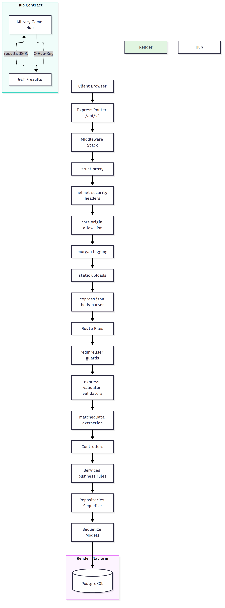
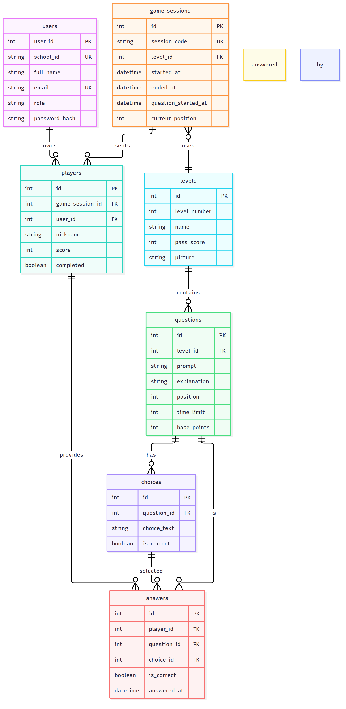

# Technical specification: Tile Quest API

Version 1.0.0, SE1 final build. Developer: Trisha Joy Gutierrez (trishajoy), BSCS 3-1. Group: Team 4.

## 1. Purpose and scope

Tile Quest is a tournament-style quiz game for the SorSU Bulan Campus library. Players match tiles and answer quiz questions in timed sessions hosted on levels (game sets). The backend API (this repository) provides authentication, question-bank management, gameplay session control, server-timed scoring, and Hub Contract results reporting. SE1 covers the backend API; SE2 will add the frontend client.

## 2. Architecture

Every HTTP request flows through the middleware stack in `src/app.js`: trust proxy, Helmet security headers, CORS (origin allow-list from `CORS_ORIGINS`), Morgan logging (non-test), static upload serving, JSON body parsing, then the route router under `/api/v1`. Each route file delegates to a controller, which calls `matchedData()` (never `req.body`) for validated input, invokes one service, and maps the result to an HTTP status. Services contain business rules and call repositories; repositories perform all Sequelize queries and transactions. Models are defined in `src/models/` and loaded once in `src/models/index.js`.

| Layer | Folder | Responsibility | Never |
|---|---|---|---|
| Routes | `src/routes` | Mount verbs, apply guards and validators, map HTTP to controllers | No business rules, no `req.body` |
| Validators | `src/validators` | `express-validator` rules for body/query/params | No database access |
| Controllers | `src/controllers` | Read validated input, call one service, pick HTTP status | No `req`/`res` passed to services |
| Services | `src/services` | Business rules, scoring, transactions | No `req`/`res`, no model directly |
| Repositories | `src/repositories` | Sequelize queries and transactions | No `req`/`res` |
| Models | `src/models` | Sequelize model definitions and associations | Used only in repositories |

## 3. Data

Eight tables in PostgreSQL, defined by migrations in `db/migrations/` and seeded by `db/seeders/`. Full column details are in `docs/data-dictionary.md`.

Database-enforced rules: `uq_users_school_id` and `uq_users_email` (unique), `ck_users_role` (PLAYER/HOST/ADMIN); `uq_levels_level_number` and `ck_levels_level_number`, `ck_levels_pass_score`; `uq_choices_one_correct_per_question` (partial unique index: exactly one correct choice per question); `uq_players_session_user` (one seat per account per game); `uq_answers_player_question` (one answer per player per question); `ck_players_score` (score >= 0); `ck_puzzles_grid` (grid_rows > 0 AND grid_cols > 0); `ck_game_sessions_times` (ended_at >= started_at). Foreign keys cascade deletes where appropriate (e.g. deleting a question deletes its choices and answers).

## 4. Security

| Concern | Decision |
|---|---|
| Passwords | bcryptjs hash with cost 10 (72-byte limit); `password_hash` hidden by default model scope; only `findForLogin` reads it; login uses a dummy hash for unknown accounts to prevent timing leakage |
| Login and tokens | HS256 JWT signed with `JWT_SECRET`; 1-hour expiry; `Authorization: Bearer <token>` header; wrong password and unknown school ID answer identically (`INVALID_CREDENTIALS`) |
| Roles | `PLAYER` (default), `HOST`, `ADMIN`; register always creates PLAYER; admin promotion via `PATCH /users/:id/role`; admin cannot change own role |
| Input | `express-validator` on all body/query/params; `matchedData()` extracts only validated fields; school_id pattern `^2099-\d{4}$`; password 8–72 chars with letter+number |
| Your game's trust boundary | The server decides time and scoring: `question_started_at` is set server-side on LOBBY→RUNNING and on each advance; elapsed time measured server-side; answer validity (correct option, current question, seated player, not already answered) enforced server-side |
| Browsers (CORS) | `CORS_ORIGINS` allow-list; unlisted origins get no `Access-Control-Allow-Origin` header; `trust proxy` enabled |
| The Hub | `X-Hub-Key` header required for `GET /results`; constant-time comparison (`crypto.timingSafeEqual`); key stored only in `.env` / Render `sync: false` env var |

## 5. Quality

81 Jest tests (unit + HTTP) across 10 test suites; 83.09% line coverage (requirement: 60%+). Postman collection: 64 requests, 127 assertions, 0 failures on a fresh `db:reset`. Automatic check (`npm run check`): 44 lines green (lines M, N, O pending live deployment and portfolio docs).

## 6. Deployment

Deployed on Render as a web service + PostgreSQL database via Blueprint (`render.yaml`). Start command: `sequelize-cli db:migrate && node scripts/create-admin.js && node src/server.js`. Free-plan limits: sleeps after 15 minutes of inactivity (~1 min cold start), database expires 30 days after creation, no persistent disk (uploaded pictures vanish on restart). Four `sync: false` values: `HUB_API_KEY`, `CORS_ORIGINS`, `ADMIN_SCHOOL_ID`, `ADMIN_PASSWORD`.

## 7. Decisions and their reasons

| Decision | Reason | Alternative not taken |
|---|---|---|
| Server-timed scoring | Prevents clients from cheating by reporting their own elapsed time; `question_started_at` set by server | Client-reported elapsed time |
| bcrypt cost 10 | Standard security/work factor balance; 72-byte bcrypt limit | Lower cost (faster but weaker) or higher cost (slower login) |
| Guards before validation | Fail fast on auth before wasting cycles on validation | Validation before guards |
| Constraint-mapped 409 instead of check-then-insert | Race-safe; uses real constraint names (`uq_users_school_id`, `uq_users_email`) | Application-level pre-check only |
| One `completed` rule (answered every question) | Simple, deterministic, matches `/results` contract | Stored `completed` column updated manually |
| Offset paging | Simple, cursor-free | Cursor-based paging (more complex) |
| Local disk uploads on Render | Simple file storage | Persistent disk (not available on free plan) |
